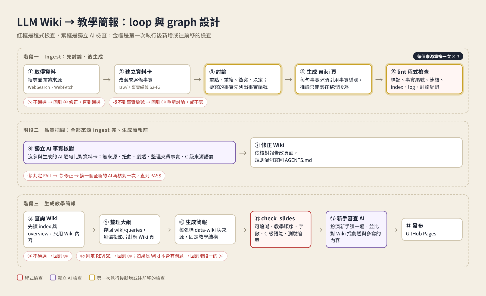

# Loop 與 Graph 設計、執行紀錄與反思

## 1. 流程

取得資料 → 建立資料卡 → 討論 → 生成 Wiki 頁 → lint 程式檢查 → 獨立 AI 事實核對 → 查詢 Wiki → 整理大綱 → 生成簡報 → 簡報程式檢查 → 新手審查 AI → 發布

| 節點 | 做什麼 | 產出 |
|---|---|---|
| ① 取得資料 | 搜尋並閱讀來源，共 7 篇 | 來源網址 |
| ② 建立資料卡 | 把來源改寫成逐條事實並編號，例如 S2-F3 | raw/ |
| ③ 討論 | 回答四個問題：最重要的三件事、和既有內容的重複補充衝突、要改哪些頁、要小心什麼 | discussions/ |
| ④ 生成 Wiki 頁 | 依討論的決定寫頁面，每句事實引用事實編號 | wiki/ |
| ⑤ lint | 程式檢查格式、引用、連結、index、log | 通過或錯誤清單 |
| ⑥ 事實核對 | 沒參與生成的 AI 逐句比對資料卡 | 核對報告 |
| ⑦ 修正 | 依報告修正，規則漏洞寫回 AGENTS.md | 新版 Wiki |
| ⑧ 查詢 | 讀 index 與 overview，只用 Wiki 內容 | 查詢結果 |
| ⑨ 大綱 | 每張投影片對應哪些 Wiki 頁 | wiki/queries/slide-outline.md |
| ⑩ 生成簡報 | 固定教學結構，每張標 data-wiki 與來源 | slides/index.html |
| ⑪ check_slides | 程式檢查可追溯性、結構、字數、語氣、答案 | 通過或錯誤清單 |
| ⑫ 新手審查 | AI 扮演新手讀一遍，並比對 Wiki 找劇透與多寫的內容 | 審查報告 |

## 2. 哪些步驟會重複執行

- ① 到 ⑤ 每個來源跑一次，總共 7 次，這是 ingest loop
- ⑤ lint 不通過就回到 ④，直到通過
- ⑥ 事實核對判定 FAIL，就修正後換一個全新的 AI 再核對一次，直到通過
- ⑪ 不通過回到 ⑩；⑫ 判定要修改回到 ⑩，如果問題出在 Wiki 本身，要回到 ④ 改 Wiki，不能只改簡報

## 3. 哪些地方需要檢查或重新生成

| 檢查點 | 類型 | 抓什麼 | 不通過時 |
|---|---|---|---|
| ⑤ lint | 程式 | 缺來源、事實編號不存在、斷掉的連結、index 與 log 不一致、缺討論紀錄 | 重新生成該頁 |
| ⑥ 事實核對 | 獨立 AI | 沒有來源支持、扭曲原意、劇透、整理段落夾帶新事實、語氣 | 修正 Wiki 並更新規則 |
| ⑪ check_slides | 程式 | 投影片追溯不到 Wiki、教學順序、字數、C 級來源語氣、測驗沒答案 | 重新生成該張 |
| ⑫ 新手審查 | 獨立 AI | 新手看不懂的地方、和 Wiki 不一致、劇透 | 重新生成該張，或回去改 Wiki |

## 4. 為什麼這樣設計

- 先討論、後生成：Wiki 是長期累積的知識，先想清楚和既有內容的關係，可以避免重複頁面與互相矛盾
- 程式檢查和 AI 檢查分開：程式擅長檢查格式與追溯，又快又穩定；但程式看不懂意思，劇透和扭曲原意只能靠 AI 讀
- 檢查的 AI 不能是生成的 AI：自己檢查自己很容易看不到問題，所以每次核對都開一個沒看過生成過程的新 AI
- 簡報只能用 Wiki：簡報的每個事實都能追溯到 Wiki 頁，再追溯到資料卡的事實編號，最後追溯到原始網址

## 5. 實際執行紀錄

所有原始輸出都在 docs/run-logs/。

| 順序 | 節點 | 結果 | 紀錄檔 |
|---|---|---|---|
| 1 | ⑤ lint 第一次 | ❌ 7 個問題：來源摘要頁的導覽行被當成事實句；lint 本身有 bug，S6 標題含有 整理 兩字，整頁被跳過 | 01-lint-first-pass.txt |
| 2 | ⑤ lint 修正後 | ✅ 通過 | 02-lint-after-fix.txt |
| 3 | ⑤ 新增查詢頁後 | ❌ 4 個規劃行沒有來源，改成說明行後 ✅ | 03-lint-after-query.txt |
| 4 | ⑥ 事實核對 v1 | ❌ 36 個問題：7 個沒有來源支持、8 個扭曲、1 個劇透、4 個整理夾帶事實、16 個語氣 | 04-fact-check-v1.md |
| 5 | ⑤ 新版 lint | ✅ 改成事實編號引用的 Wiki 通過；同一支 lint 檢查舊版 Wiki 抓出 76 處 | 05-lint-v2.txt、06-new-lint-on-v1.txt |
| 6 | ⑪ check_slides 第一次 | ❌ 4 個問題：密室投影片只靠 C 級來源卻沒有保守語氣、參考資料頁字數 | 07-check-slides-v1.txt |
| 7 | ⑪ 修正後 | ✅ 通過，但沒有抓到第 9 張的劇透 | 08-check-slides-v2.txt |
| 8 | ⑥ 事實核對 v2 | ❌ 沒有來源支持與扭曲歸零；剩 2 個劇透、1 個語氣，修正 | 09-fact-check-v2.md |
| 9 | ⑫ 新手審查 v1 | ❌ 需要修改：劇透、術語沒先解釋、例子離概念太遠、練習案件沒有公布答案、檢查程式漏掉 data-wiki 與標記格式 | 12-review-slides-v1.md |
| 10 | ⑪ 加強後的 check_slides | ✅ 新版簡報通過；同一支程式檢查舊版簡報抓出 2 個原本漏掉的問題 | 10-check-slides-v3.txt、11-new-checker-on-slides-v1.txt |
| 11 | ⑫ 新手審查 v2 | ✅ 可以發布，但有 8 個中等問題，多半是簡報補充說明加了 Wiki 沒有的背景知識 | 13-review-slides-v2.md |
| 12 | ⑪ 修正後 check_slides | ❌ 2 個問題，修正後 ✅ | 14-check-slides-v4.txt |

## 6. 反思

### 哪一個節點最常出錯？
④ 生成 Wiki 頁。第一次事實核對的 36 個問題全部出在這裡，最嚴重的是把 ③ 討論裡自己推出來的結論，寫成帶有來源標記的事實。例如討論時推測 Van Dine 反對密室，生成時就寫成 Van Dine 把佈置的密室列為老套 [S2]，但 S2 資料卡根本沒有這一條。
這個錯誤 lint 完全抓不到，因為 lint 只檢查有沒有標記，不檢查標記的來源是否真的這樣說。

### 把檢查往前移到了哪一個步驟？
從 ⑥ 事後的事實核對，往前移到 ③ 討論與 ④ 生成：
1. ④ 生成時，概念頁的每一句事實都必須引用到事實編號，例如 [S2-F11]，不能只寫 [S2]。找不到事實編號，就代表這句話沒有來源，根本寫不出來
2. ③ 討論時，要寫成事實的內容必須先列出事實編號；推論與衝突分析只能放進整理段落
3. ⑤ lint 強制檢查事實編號存在
改版後的第二次事實核對，沒有來源支持與扭曲原意都從 15 個降到 0 個。

簡報端也做了一樣的事：新手審查發現的 data-wiki 缺漏與標記格式問題，寫進 check_slides 程式，下次在 ⑪ 就會被擋下，不用等到 ⑫。

### 有沒有因此修改 workflow 或 graph？為什麼？
有，改了三處，流程圖中金框的節點就是改過的地方：
1. ③ 與 ④ 加上事實編號的要求：把最常出錯的問題擋在產生的當下，比事後核對便宜
2. ⑥ 核對不通過時，換一個全新的 AI 再核對，而不是請同一個 AI 確認：避免檢查員被自己上一輪的判斷影響
3. 劇透規則從不能寫結局，擴大成誤導手法類的頁面不列作品名稱：第二次核對發現，句子本身完全正確，但說出某部作品用了不可靠敘事者，就等於說出反轉。這是事實編號擋不住的問題，只能寫成規則，並留給 AI 審查把關

### 第二名：⑩ 生成簡報
第二次新手審查發現，簡報和 Wiki 犯了同一種錯：為了讓新手看懂而補上的人物介紹與名詞解釋，例如 Ellery Queen 是筆名、Knox 是英國人，都不在 Wiki 裡。
這些句子看起來只是說明，卻是沒有來源的事實。處理方式和 Wiki 一樣，把檢查往前移到生成當下：AGENTS.md 規定補充說明也必須來自 Wiki，Wiki 沒有就先回去補，否則不寫；Wiki 以外的內容只能是明確標示的 本簡報的觀點 或 自編 案例。

另外也學到：程式檢查本身也會有 bug，第一次 lint 就因為標題含有 整理 兩字而跳過整頁。所以每次改檢查程式，都要拿舊版資料跑一次，確認它真的抓得到問題。
